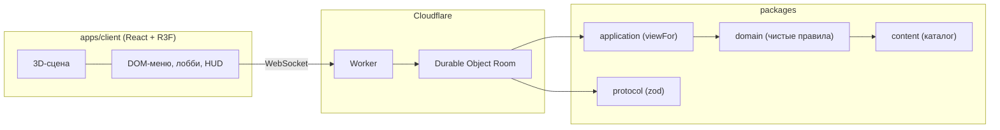

# Card Wars v3

Онлайн-версия настольной карточной игры **Card Wars** (Adventure Time) для 2–4 игроков: 3D-стол прямо в браузере, комнаты по коду, боты, редактор колод и мультяшный интерфейс из войлока и бумаги.

> Проект неофициальный, фанатский, переписан с нуля по документации (clean-room).

## Об игре

Каждый игрок — герой с колодой из 40 карт и четырьмя землями. Побеждает тот, кто остался последним на ногах.

- **Земли.** У каждого игрока 4 земли; тип земли определяет, какие карты можно сыграть (всего 7 типов).
- **Карты.** Существа, строения, заклинания и парные карты (только 2v2).
- **Ход.** Добор → основная фаза (2 действия на розыгрыш карт, Флюп, дополнительный добор) → бой: готовые существа атакуют существо напротив или игрока.
- **Флюп.** Применение способности карты: удерживайте карту на поле.
- **Жизни.** 25 у игрока, 40 у команды в 2v2.

### Режимы

| Режим | Игроки | Описание |
|-------|:------:|----------|
| 1 на 1 | 2 | Классическая дуэль |
| Каждый за себя | 3–4 | Бьют ближайшего противника, соседи меняются по ходу игры |
| 2 на 2 «соседи» | 4 | Две команды с общими жизнями, парные карты |
| 2 на 2 «стенка» | 4 | Команда делит один ряд из 8 зон |

Можно добавлять серверных ботов, создавать закрытые комнаты и играть с любым составом.

### Контент

853 карты · 74 героя · 44 арта земель. Способности структурированы данными (837 карт, 25 героев) и исполняются доменным движком; колоды импортируются и экспортируются кодом.

## Возможности

- 3D-стол на react-three-fiber: квадратный коврик, анимации по событиям, прогноз боя, жетоны урона и льда.
- Интерфейс в стиле «войлок и бумага» (зелёные и бежевые тона), мобильная адаптация, PWA.
- Предпросмотр карты правой кнопкой мыши, правая боковая панель с журналом и действиями.
- Редактор колод: выбор героя из галереи, выбор арта каждой земли, код колоды копируется в буфер обмена.
- Лобби с рассадкой игроков, готовностью и ботами.
- Таймеры хода, «Поторопить», переподключение после обрыва.

## Архитектура



- **Авторитетный сервер.** Состояние матча живёт только в Durable Object `Room`; клиент шлёт команды и получает личные снапшоты.
- **Скрытие информации.** Чужая рука и колода не покидают сервер; персональный вид строит только `viewFor`.
- **Чистый домен.** `packages/domain` зависит только от Immer; случайность — через сидированный RNG, поэтому матчи воспроизводимы.
- **Данные вместо хардкода.** Карты и способности читаются из `packages/content`; в правилах нет ссылок на конкретные карты.
- **Протокол.** Схемы zod лежат в `packages/protocol`, версия — `PROTOCOL_VERSION = 3`.

## Стек

TypeScript (strict) · pnpm workspaces · React 19 · Vite · Three.js + react-three-fiber · Zustand · zod · Immer · Cloudflare Workers + Durable Objects · Vitest + fast-check.

## Структура репозитория

```
apps/client      Клиент: DOM-интерфейс и 3D-сцена
apps/server      Worker и Durable Object Room, боты
packages/domain  Правила игры
packages/application  Персональные виды и журнал
packages/protocol     Схемы сообщений и CONFIG
packages/content      Каталог карт, героев, земель
content/         Исходные данные и сканы
docs/            Документация и аудиты
tools/           Генерация каталога, версии
```

Подробнее — [docs/STRUCTURE.md](docs/STRUCTURE.md).

## Быстрый старт

Нужны Node.js 22+ и pnpm 12.

```bash
pnpm install
pnpm -r build                                  # пакеты + клиент
pnpm --filter @card-wars/server dev            # Worker + Durable Object на http://127.0.0.1:8787
```

На Windows достаточно запустить `start.bat`: он ставит зависимости, собирает клиент, поднимает сервер и открывает браузер.

### Команды

| Команда | Что делает |
|---------|-----------|
| `pnpm lint` | ESLint по всему репозиторию |
| `pnpm typecheck` | `tsc --noEmit` во всех пакетах |
| `pnpm -r test` | Тесты (Vitest, сидированный RNG) |
| `pnpm -r build` | Сборка пакетов и клиента |
| `pnpm --filter @card-wars/content generate` | Пересборка каталога из `content/` |
| `pnpm --filter @card-wars/server smoke` | e2e «две вкладки» (нужен запущенный сервер) |
| `pnpm --filter @card-wars/server smoke:bots` | e2e 2 на 2 с ботами (нужен запущенный сервер) |

### Деплой

```bash
pnpm deploy          # версия → сборка → wrangler deploy
```

или `deploy.bat` на Windows (проверит вход в Cloudflare). Конфигурация — [apps/server/wrangler.jsonc](apps/server/wrangler.jsonc): статические ассеты клиента, привязка Durable Object `ROOM`, миграция SQLite-класса `Room`.

## CI

GitHub Actions ([ci.yml](.github/workflows/ci.yml)): `lint`, `typecheck`, `test`, `build` на Node 22.

## Документация

Начните с [docs/README.md](docs/README.md). Правила — [docs/RULES.md](docs/RULES.md), стек — [docs/TECH.md](docs/TECH.md), аудиты проекта — [docs/audits](docs/audits/README.md). Правила работы с кодом — [AGENTS.md](AGENTS.md).
