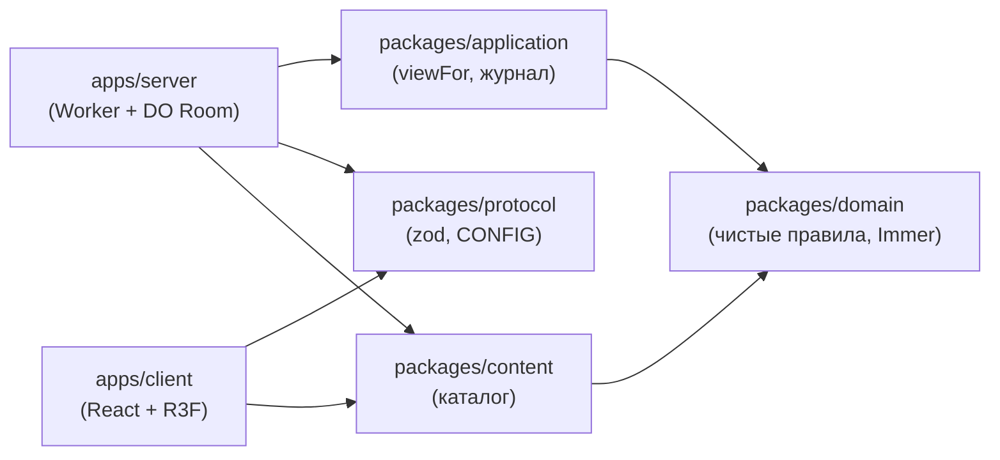

# Аудит архитектуры

## Граф пакетов

## Проверка семи конвенций `AGENTS.md`

| # | Конвенция | Результат |
|---|-----------|-----------|
| 1 | `domain` чист: нет I/O, `Math.random`, часов; единственная зависимость — Immer | ✅ `package.json`: только `immer`; в исходниках нет `Math.random`, `Date.now`, `fetch`, `console` (единственное совпадение — комментарий в `index.ts`) |
| 2 | Нет хардкода карт | ✅ id карт и героев в коде правил не найдены; совпадения по шаблону — только названия команд (`hero_ability`) |
| 3 | Константы правил только из CONFIG | ✅ `packages/protocol/src/config.ts` — единственный источник; сервер реэкспортирует его (`apps/server/src/config.ts`), домен получает `GameConfig` через порт |
| 4 | Скрытие информации через `viewFor` | ✅ в `PlayerViewSchema` — только `myHand`, `myPeek`, `myWord`; у соперников `handCount`/`deckCount`. Смоук-тест проверяет отсутствие `instanceId` чужой руки |
| 5 | Тонкий UI | ✅ клиент заменяет снапшот целиком; законность ходов решает домен |
| 6 | Языки | ✅ идентификаторы и комментарии — английский, интерфейс и документы — русский |
| 7 | zod только на границе | ✅ схемы в `packages/protocol`; домен без zod |

## Cloudflare

- Worker маршрутизирует `/ws` в DO `Room` по четырёхзначному коду (`apps/server/src/index.ts`).
- `Room` использует **Hibernatable WebSockets**: `ctx.acceptWebSocket`, `serializeAttachment`, `ctx.getWebSockets()` — комната переживает выгрузку из памяти.
- Таймеры, боты и ожидание переподключения идут через `alarm()`/`setAlarm`.
- Состояние пишется целиком: `ctx.storage.put('room', state)` (`room.ts:117`) в DO-классе с SQLite-бэкендом (`new_sqlite_classes` в `wrangler.jsonc`). Прежние формулировки «SQLite write-through» в документах неточны.
- Версия протокола проверяется при `join` (`room.ts:285`).
- Журнал ограничен 500 строками (`MAX_JOURNAL_LINES`).

## Находки

| # | Приоритет | Находка | Рекомендация |
|---|-----------|---------|--------------|
| A1 | P1 | События игры рассылаются всем игрокам (широковещательно); приватные окна (`peeks`) намеренно не порождают событий, но защита держится на дисциплине | Тест-инвариант: JSON каждого события не содержит `instanceId` из рук других игроков |
| A2 | P1 | Версия протокола продублирована в смоук-скриптах (рассинхрон уже случился) | Импортировать `PROTOCOL_VERSION` из `@card-wars/protocol` |
| A3 | P2 | Полная сериализация `RoomState` при каждой команде | См. [04-performance.md](./04-performance.md): писать только изменившиеся ключи или использовать `ctx.storage.sql` |
| A4 | P2 | `legacy-cards.json`/`legacy-heroes.json` были подмешаны в `packages/content/src/index.ts` | ✅ Вынесены в `packages/content/src/__fixtures__/` только для тестов `golden.test.ts` и `h1.test.ts` |
| A5 | P2 | В `TECH.md`/`UI-3D.md` и в навыках `.agents/skills/threejs-*` упомянут `@react-three/drei` и `OrbitControls`, хотя зависимости нет (камера — собственный `CameraRig`) | Обновить документы и навыки |
| A6 | P2 | Бот использует эвристику вне домена и принимает решения по `PlayerView` — это верно, но дублирует часть проверок земель (`landRequirementMet`) | Допустимо; при росте логики вынести в пакет `bots` |
